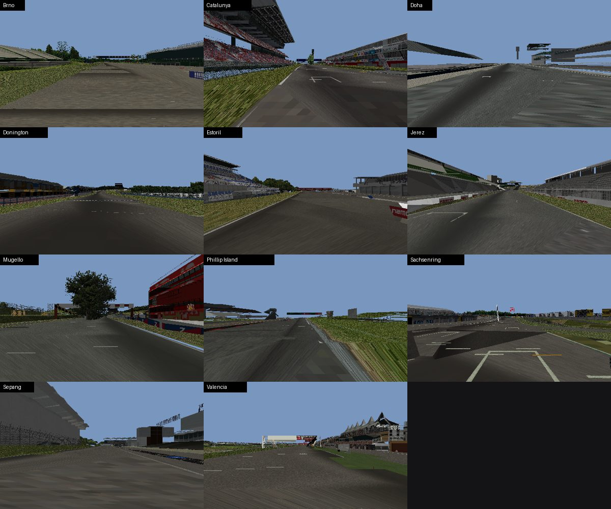

# MotoGP 08 + MotoGP 4 (PS2)

Mod de PS2 que usa o **MotoGP 08** (Milestone/Capcom, 2008) como base e traz as
**motos e pistas do MotoGP 4** (Namco, 2005), com bots mais agressivos e uma
câmera de TV a mais.

- **Alvo:** XBSX2 (versão do PCSX2 para Xbox) e PCSX2.
- **Entrega:** a ISO modificada é montada a partir da ISO original de cada
  jogador, por uma página que funciona no navegador do iPhone, Android ou PC.

## Como instalar (iPhone, Android ou PC)

1. Tenha a ISO original **MotoGP 08 (USA)** no aparelho (no iPhone, no app
   Arquivos: no app do Google Drive, toque nos três pontos da ISO > Abrir em >
   Salvar em Arquivos).
2. Abra no navegador:
   **https://raw.githack.com/imdotizz-ship-it/ps2/claude/ps2-game-mods-drastic-3mwmob/patcher/index.html**
3. Escolha a ISO, ajuste o FOV se quiser, toque em **Criar ISO** e depois em
   **Salvar**. A página baixa só o patch (51 MB); a ISO é montada no próprio
   aparelho e não é enviada para lugar nenhum.

No iPhone precisa do iOS 16.4 ou mais novo, e a tela deve ficar ligada até
terminar. A ISO nova (1,9 GB) vai para a pasta Downloads do app Arquivos.

## O que muda

| Mod | Detalhes |
| --- | -------- |
| Motos do MotoGP 4 | As seis motos da MotoGP com carenagem, quadro, motor, escapamento, para-brisa e pinturas do MotoGP 4 ([detalhes](#motos-do-motogp-4-no-motogp-08)) |
| Pistas do MotoGP 4 | Brno, Catalunya, Doha, Donington, Estoril, Jerez, Mugello, Phillip Island, Sachsenring, Sepang e Valência com o visual do MotoGP 4 ([detalhes](docs/formats/pistas.md)) |
| Bots que caem mais | Cada piloto da CPU tem o dobro da chance de cair (na pista, fora dela e de a queda ser um highside), nas três categorias, e guarda metade da distância dos outros |
| Grid competitivo | Todos os pilotos da CPU com o ritmo do mais rápido da categoria (acelerador, tempos de classificação), em todas as dificuldades, no seco e na chuva; todas as motos de cada categoria com o torque da mais forte (MotoGP 94, 250cc 58, 125cc 31), mantendo câmbio, aderência e manejo de cada uma; ataques começam de mais longe (15 m) e defender não tira velocidade. As chances de queda continuam individuais (e dobradas) |
| Toques estilo takedown | Um toque entre motos derruba com menos diferença de velocidade (92 → 55) e empurra 2,5 vezes mais forte; bater numa moto caída derruba mais cedo; as rivalidades entre pilotos pioram mais rápido a cada batida |
| Câmeras | Câmera de TV (alta, atrás da moto) no botão de trocar câmera; tremor da câmera acima de 180 km/h; efeito de velocidade da câmera começando em 100 km/h (era 148) |
| FOV ajustável | Controle deslizante na página de instalação: 60° a 110° nas câmeras da corrida (70° é o original) |
| Câmera livre do replay | A câmera Orbit do replay gira mais rápido, vai de baixo até em cima da moto e fica mais longe |
| Safety Car (experimental, opcional) | A BMW M6 Safety Car do MotoGP 4 como uma equipe e um piloto a mais, marcada na página de instalação |

Nas pistas, colisão, traçado da IA, grid, câmeras de replay e cronometragem
continuam as do MotoGP 08, então as corridas funcionam normalmente; muda o
que se vê. Assen, Le Mans e Motegi continuam com o visual do 08 (veja o
porquê em [pistas](docs/formats/pistas.md#resultado)), e Indianápolis, Laguna
Seca, Misano e Xangai não existem no MotoGP 4.

**Testado no emulador PCSX2** (compilado a partir do código-fonte, com BIOS
PAL v1.60): a ISO completa inicia, e a Corrida Rápida roda em Losail e em Jerez
com as motos e as pistas do MotoGP 4, em velocidade normal. Para isso foi
preciso:

- gerar a geometria das motos no formato nativo do PS2 (`tools/mgp4to08/ps2native.py`):
  o jogo trava se tiver que converter sozinho o modelo de uma moto;
- não acrescentar texturas às motos (uma a mais já corrompe a imagem): as
  texturas do MotoGP 4 vão num atlas no lugar da pintura original;
- dar a cada material das pistas o seu próprio "efeito" do motor Selene (sem
  isso o asfalto saía azul-claro, da cor do céu).

Ainda não testados no emulador: o Safety Car, cada uma das 11 pistas (só
Losail e Jerez foram corridas) e o hardware real.



A imagem acima vem de um renderizador simples feito para conferir o encaixe,
não do jogo: sem iluminação, sem filtragem de textura (por isso o asfalto
fica serrilhado), céu chapado e câmera presa à linha da IA. No jogo as pistas
usam a iluminação, o céu e a filtragem do 08. Defeitos reais que a imagem
também mostra: o MotoGP 4 e o 08 não têm traçados idênticos, então há trechos
esticados pela deformação, chão preenchido com triângulos da colisão do 08
onde o MotoGP 4 não tinha nada, e peças pequenas cortadas pelo limite de
triângulos.

### Safety Car (opcional)

A BMW M6 da pintura "Safety Car" do MotoGP 4 vira o modelo `BIKE07` e ganha
uma equipe e um piloto próprios. Limites, porque o motor do 08 só simula
motos: ela anda e inclina como moto (física da Honda RC212V), as rodas não
giram, o piloto do 08 fica sentado dentro dela, e a forma de colisão foi
esticada para o tamanho do carro (1,9 m × 4,8 m). O jogo não tem textos para
ela, então nos menus aparecem os nomes da Repsol Honda e do Hayden. Como a
grade passa a ter 19 pilotos, pode travar nos menus ou ao montar o grid: por
isso é uma opção separada na página.

## Desafio principal

Os dois jogos são de estúdios diferentes e usam engines diferentes. Por isso,
nenhum arquivo do MotoGP 4 funciona direto no MotoGP 08: cada tipo de dado
(modelo 3D, textura, colisão, traçado da IA) precisa ser decodificado nos dois
jogos e convertido de um formato para o outro.

## Fases

| Fase | Objetivo | Status |
| ---- | -------- | ------ |
| 0 | Mapear os arquivos das duas ISOs (pacotes, compressão, onde ficam motos e pistas) | Concluída: `.MIX` do MotoGP 08 ([formato](docs/formats/mix.md)) e `MOTOGP.DAT` do MotoGP 4 ([formato](docs/formats/gp4dat.md)) abertos |
| 1 | Desempacotar e reempacotar os arquivos do MotoGP 08 sem quebrar o jogo | Concluída |
| 2 | Trocar texturas e pinturas das motos | Concluída junto com a fase 3 |
| 3 | Converter os modelos 3D das motos do MotoGP 4 para o formato do MotoGP 08 | Concluída |
| 4 | Pistas: visual do MotoGP 4 sobre colisão, IA, câmeras e cronometragem do 08 | Concluída em 11 das 14 pistas em comum |
| 5 | Jogabilidade: IA, câmeras, colisões, veículo novo | Feito por dados ([BML](docs/formats/bml.md)): quedas, takedowns, câmeras, FOV na instalação, Safety Car experimental. Câmera livre com L1+R1 e o resto que exige mudar o código do jogo: não feito (veja abaixo) |

### O que não foi feito

Estes pedidos exigem escrever código novo dentro do executável do PS2
(`SLUS_218.11`), e isso não dá para fazer sem um emulador para testar: um erro
trava a ISO inteira. O emulador Play! (que roda sem BIOS) não pôde ser baixado
aqui porque a política de rede deste ambiente bloqueia os downloads do
github.com.

- **Câmera livre com L1+R1 durante a corrida** (câmera de desenvolvedor). O
  mais perto disso hoje é a câmera Orbit do Replay, que ficou mais livre.
- **FOV ajustável dentro do jogo.** O FOV é escolhido na página de
  instalação. As opções dos menus não são uma lista que o jogo lê dos
  dados: cada uma (`KmUnit`, `TrackMap`...) tem nome fixo no executável, uma
  tela pronta (`.mwf`) e código que aplica o valor. Uma opção nova precisa
  dos três, e o código das câmeras precisaria ler o valor novo.
- **Motion blur forte.** O PS2 não tem desfoque de movimento nas câmeras de
  corrida; o que existe é o efeito de velocidade da câmera, que agora começa
  mais cedo, e o tremor em alta velocidade.
- **Sistema de takedown do Burnout** (câmera lenta, pontuação). Os toques
  derrubam mais, mas sem a câmera e as regras do Burnout.
- **Pilotos se xingando com caixas de diálogo e áudio.** Os pilotos já fazem
  gestos de raiva (animações `rabbia`) e têm rivalidades, que agora pioram
  mais rápido; texto e voz novos não.
- **Ragdoll nas quedas e deformação estilo Burnout.** As quedas do 08 são
  animações prontas, e os modelos não deformam.
- **Física de carro para o Safety Car.** O motor só simula motos.

## Patches

O patch completo fica em `patcher/` (página `index.html`, `manifest.json` e as
partes `part-NN.patch`), aplicado pela página acima ou no PC com
`python3 tools/isopatch.py apply "MotoGP 08 (USA).iso" patcher saida.iso`
(com `--option fov=90` e `--profile safetycar` para as escolhas). Ele
parte da ISO original **MotoGP 08 (USA)** (SHA-1
`25cdef00791ac502dfad8a21b1f39b64b58fc361`) e confere a ISO final por SHA-1
(`941fde03f41cfa198ce30572f3fb091054dda024` com FOV 70 e sem Safety Car; as
outras combinações estão no `manifest.json`).

Os patches xdelta antigos continuam valendo (Delta Patcher, UniPatcher ou
`xdelta3 -d -s "MotoGP 08 (USA).iso" PATCH.xdelta SAIDA.iso`):

| Patch | O que faz | SHA-1 da ISO resultante |
| ----- | --------- | ----------------------- |
| `patches/teste-moto-azul.xdelta` | Teste do fluxo: a moto vermelha do primeiro slot (BIKE01) fica azul | `854013d5cbc693ccd9241ebbd30044493f08ef3b` |
| `patches/motos-motogp4.xdelta` | Só as motos do MotoGP 4 | `67dbe53613467e9696ee0e14a79cbae4a7f404fc` |

### Motos do MotoGP 4 no MotoGP 08


Cada modelo do 08 atende duas ou três equipes e recebeu uma moto do MotoGP 4
do mesmo fabricante:

| Modelo do 08 | Equipes no 08 | Moto do MotoGP 4 |
| ------------ | ------------- | ---------------- |
| BIKE01 | Ducati Marlboro, Alice | Ducati #65 (Capirossi) |
| BIKE02 | Rizla Suzuki | Suzuki #21 (Hopkins) |
| BIKE03 | Kawasaki | Kawasaki #56 (Nakano) |
| BIKE04 | Repsol Honda | Repsol Honda #69 (Hayden) |
| BIKE05 | Fiat Yamaha, Tech 3 | Gauloises Yamaha #46 (Rossi) |
| BIKE06 | Hondas satélites (Gresini, LCR, JiR) | Movistar Honda #15 (Gibernau) |

O que muda: carenagem, quadro, motor, escapamento, rabeta, painel e
para-brisa (com os dois níveis de detalhe). Rodas, garfo, balança, guidão e
corrente continuam os do 08, então a física e as animações do piloto não
mudam. As placas de número do 08 ficam escondidas, porque as pinturas do
MotoGP 4 já trazem os números. Todas as equipes do mesmo modelo usam a mesma
moto do MotoGP 4, já que no 08 a geometria é compartilhada por modelo.

Para refazer (ou escolher outras motos, com `--map BIKE05=tec_17` por exemplo):

```sh
pip install numpy pillow
python3 tools/ps2iso.py extract "MotoGP 08 (USA).iso" extracted/mgp08 BIKES.MIX
python3 tools/ps2iso.py extract "MotoGP 4 (USA).iso" extracted/mgp4 'SLUS_211.59' MOTOGP.DAT
python3 tools/gp4dat.py extract extracted/mgp4/SLUS_211.59 extracted/mgp4/MOTOGP.DAT extracted/mgp4_x
python3 tools/bikes4to08.py build extracted/mgp08/BIKES.MIX extracted/mgp4_x build
python3 tools/ps2iso.py replace "MotoGP 08 (USA).iso" build/mgp08_m4bikes.iso BIKES.MIX=build/BIKES.MIX
python3 tools/bikes4to08.py preview build/BIKES.MIX build/preview.png   # confere sem emulador
```

Para refazer o patch de teste a partir dos arquivos extraídos:

```sh
python3 tools/rwtxd.py recolor BIKES/BIKE01/PICTURES/BIKE01.TXD BIKE01.TXD bgr 'CHASSIS*'
python3 tools/mix.py replace BIKES.MIX BIKES_mod.MIX 'BIKES\BIKE01\PICTURES\BIKE01.TXD=BIKE01.TXD'
python3 tools/ps2iso.py replace "MotoGP 08 (USA).iso" teste.iso BIKES.MIX=BIKES_mod.MIX
```

## ISOs usadas

| Jogo | Serial | Tamanho | SHA-1 |
| ---- | ------ | ------- | ----- |
| MotoGP 08 (USA) | SLUS-21811 | 1.631.027.200 | `25cdef00791ac502dfad8a21b1f39b64b58fc361` |
| MotoGP 4 (USA) | SLUS-21159 | 1.239.285.760 | `d9bb4666d57a86ddbba6ab985ea0e12e8a55c843` |

## Ferramentas

### `tools/ps2iso.py`

Lê ISOs de PS2 usando só o Python padrão (3.8+), sem instalar nada. Funciona com
`.iso` (DVD) e com `.bin` raw de 2352 bytes (CD).

```sh
python3 tools/ps2iso.py info    MotoGP08.iso                 # serial do jogo e resumo
python3 tools/ps2iso.py summary MotoGP08.iso                 # tipos de arquivo por extensão e assinatura
python3 tools/ps2iso.py list    MotoGP08.iso --magic         # todos os arquivos + primeiros bytes
python3 tools/ps2iso.py extract MotoGP08.iso extracted/mgp08 # extrai tudo
python3 tools/ps2iso.py extract MotoGP08.iso extracted/mgp08 'DATA/*.PAK'  # só o que casar com o padrão
python3 tools/ps2iso.py replace MotoGP08.iso MotoGP08_mod.iso BIKES.MIX=BIKES_mod.MIX  # troca arquivos
```

A saída de `summary` e de `list --magic` é só texto e já basta para começar a
identificar os formatos, sem precisar enviar a ISO inteira.

`replace` gera uma cópia da ISO com arquivos trocados. Se o arquivo novo
couber nos setores do antigo, ele é gravado no mesmo lugar; se não, vai para o
fim da imagem.

### `tools/mix.py`

Lista, extrai e remonta os pacotes `.MIX` do MotoGP 08, já com os nomes
decifrados. Remontar sem mudanças gera um arquivo idêntico ao original (testado
nos 33 pacotes).

```sh
python3 tools/mix.py list    extracted/mgp08/BIKES.MIX
python3 tools/mix.py extract extracted/mgp08/TRACKS/JEREZ.MIX extracted/mgp08_x
python3 tools/mix.py extract extracted/mgp08/TRACKS/JEREZ.MIX extracted/mgp08_x 'TRACKS\JEREZ\*.SPL'
python3 tools/mix.py replace extracted/mgp08/BIKES.MIX BIKES_mod.MIX 'BIKES\BIKE01\PICTURES\BIKE01.TXD=novo.TXD'
```

### `tools/rwtxd.py`

Lista as texturas de um `.TXD` (RenderWare de PS2) e recolore as paletas,
trocando os canais de cor. Usado no patch de teste.

### `tools/bikes4to08.py` e `tools/mgp4to08/`

Conversor das motos do MotoGP 4 para o MotoGP 08 (veja acima). Precisa de
`numpy` e `Pillow`. Os módulos em `tools/mgp4to08/` leem os modelos e as
texturas dos dois jogos ([SLF/TXD do 08](docs/formats/slf.md),
[OBJ10001/TEX10001 do MotoGP 4](docs/formats/obj10001.md)) e gravam
RenderWare. Também têm um rasterizador simples para gerar prévias.

`tools/mix.py replace` ganhou `--rename OLD=NEW` (precisa vir depois dos
`NAME=FILE`), usado para esconder o `.SLI` de um modelo.

### `tools/gp4dat.py`

Lista e extrai o `MOTOGP.DAT` do MotoGP 4, já descompactado. Precisa do
executável do jogo, onde fica o índice.

```sh
python3 tools/gp4dat.py list    extracted/mgp4/SLUS_211.59 extracted/mgp4/MOTOGP.DAT
python3 tools/gp4dat.py extract extracted/mgp4/SLUS_211.59 extracted/mgp4/MOTOGP.DAT extracted/mgp4_x 'CourseJerez*'
```

### `tools/tracks4to08.py`

Converte uma pista do MotoGP 4 para o `.MIX` da mesma pista no MotoGP 08
([como funciona](docs/formats/pistas.md)). Precisa de `numpy`, `scipy` e
`Pillow`.

```sh
python3 tools/tracks4to08.py build   extracted/mgp08/TRACKS/JEREZ.MIX extracted/mgp4_x build/tracks
python3 tools/tracks4to08.py preview build/tracks/JEREZ.MIX build/jerez.png   # seis vistas do piloto
```

### `tools/data08.py` e `tools/bml.py`

`data08.py` aplica os mods de jogabilidade (IA, grid competitivo, física das motos e câmeras) no `DATA.MIX`.
`bml.py` lê e edita os `.BML` do jogo ([formato](docs/formats/bml.md)).

```sh
python3 tools/data08.py extracted/mgp08/DATA.MIX build
python3 tools/bml.py dump extracted/mgp08_x/DATA/AIPARAMS.BML
```

### `tools/isopatch.py`

Gera e aplica o patch da pasta `patcher/`: o que é igual à ISO original é
copiado dela, e só os dados novos ficam no patch, compactados. A página
`patcher/index.html` faz a mesma montagem no navegador, sem carregar a ISO
inteira na memória.

```sh
python3 tools/isopatch.py make  "MotoGP 08 (USA).iso" patcher BIKES.MIX=build/BIKES.MIX DATA.MIX=build/DATA.MIX TRACKS/JEREZ.MIX=build/tracks/JEREZ.MIX ...
python3 tools/isopatch.py apply "MotoGP 08 (USA).iso" patcher saida.iso
```

### Refazer o patch completo

```sh
pip install numpy scipy pillow
tools/build_patch.sh "MotoGP 08 (USA).iso" "MotoGP 4 (USA).iso" build   # cerca de uma hora
```

### `tools/safetycar.py`

Põe o Safety Car do MotoGP 4 no `BIKES.MIX` como `BIKE07`
([código](tools/mgp4to08/car.py)); `data08.py --safety-car` cria a equipe, o
piloto e o veículo que o usam.

## Regras do repositório

- Nunca faça commit de ISOs nem de arquivos extraídos dos jogos (o `.gitignore`
  já bloqueia os formatos comuns). Use apenas cópias dos seus próprios discos.
- O repositório guarda só ferramentas, scripts, documentação dos formatos e patches.

## Skills instaladas

- `.claude/skills/reverse-engineer-anything`: skill do
  [REA](https://github.com/morluto/rea) (licença MIT, commit `ca2d15b`). Ela
  orienta a análise de binários e depende do servidor MCP do REA e do Ghidra
  para funcionar por completo. A análise MIPS do REA só aceita ELFs MIPS32r2 e
  recusa variantes específicas de máquina, então os executáveis de PS2
  (Emotion Engine / R5900) não são suportados por ele. Para esses, o caminho é o
  Ghidra com uma extensão para o Emotion Engine.
