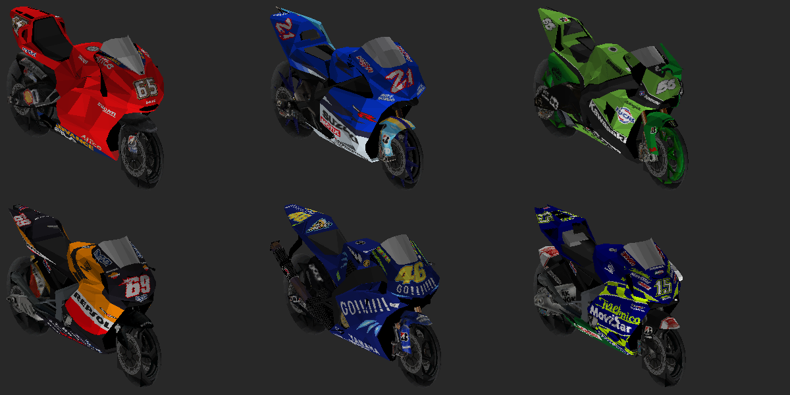

# MotoGP 08 + MotoGP 4 (PS2)

Mod de PS2 que usa o **MotoGP 08** (Milestone/Capcom, 2008) como base e traz as
**motos e pistas do MotoGP 4** (Namco, 2005).

- **Alvo:** XBSX2 (versão do PCSX2 para Xbox) e PCSX2.
- **Entrega:** uma ISO modificada do MotoGP 08, distribuída como patch (xdelta)
  aplicado sobre a ISO original de cada jogador.

## Desafio principal

Os dois jogos são de estúdios diferentes e usam engines diferentes. Por isso,
nenhum arquivo do MotoGP 4 funciona direto no MotoGP 08: cada tipo de dado
(modelo 3D, textura, colisão, traçado da IA) precisa ser decodificado nos dois
jogos e convertido de um formato para o outro.

## Fases

| Fase | Objetivo | Status |
| ---- | -------- | ------ |
| 0 | Mapear os arquivos das duas ISOs (pacotes, compressão, onde ficam motos e pistas) | Concluída: `.MIX` do MotoGP 08 ([formato](docs/formats/mix.md)) e `MOTOGP.DAT` do MotoGP 4 ([formato](docs/formats/gp4dat.md)) abertos |
| 1 | Desempacotar e reempacotar os arquivos do MotoGP 08 sem quebrar o jogo | Ferramentas prontas. Patch de teste (`patches/teste-moto-azul.xdelta`) |
| 2 | Trocar texturas e pinturas das motos (primeiro resultado visível) | Concluída junto com a fase 3 |
| 3 | Converter os modelos 3D das motos do MotoGP 4 para o formato do MotoGP 08 | Concluída: `patches/motos-motogp4.xdelta` (aguardando teste no XBSX2) |
| 4 | Pistas: visual, colisão, traçado da IA, câmeras e cronometragem | — |
| 5 | Mods de código no executável do 08: câmera livre ativada com L1+R1, opções novas no menu | — |

A fase 4 é a mais difícil. Uma pista não é só o visual: o jogo precisa da
colisão, do traçado que a IA segue, dos pontos de largada, dos setores de
cronometragem e das câmeras.

## Patches

Os mods são distribuídos como patches xdelta, aplicados sobre a ISO original
**MotoGP 08 (USA)** (SHA-1 `25cdef00791ac502dfad8a21b1f39b64b58fc361`):

- Android: app UniPatcher (arquivo da ROM = ISO original, patch = `.xdelta`).
- PC: Delta Patcher, ou `xdelta3 -d -s "MotoGP 08 (USA).iso" PATCH.xdelta SAIDA.iso`.

| Patch | O que faz | SHA-1 da ISO resultante |
| ----- | --------- | ----------------------- |
| `patches/teste-moto-azul.xdelta` | Teste do fluxo: a moto vermelha do primeiro slot (BIKE01) fica azul | `854013d5cbc693ccd9241ebbd30044493f08ef3b` |
| `patches/motos-motogp4.xdelta` | As seis motos da MotoGP com carenagem, quadro, motor, escapamento, para-brisa e pinturas do MotoGP 4 | `67dbe53613467e9696ee0e14a79cbae4a7f404fc` |

### Motos do MotoGP 4 no MotoGP 08



Cada modelo do 08 atende duas ou três equipes e recebeu uma moto do MotoGP 4
do mesmo fabricante:

| Modelo do 08 | Equipes no 08 | Moto do MotoGP 4 |
| ------------ | ------------- | ---------------- |
| BIKE01 | Ducati Marlboro, Alice | Ducati #65 (Capirossi) |
| BIKE02 | Rizla Suzuki | Suzuki #21 (Hopkins) |
| BIKE03 | Kawasaki | Kawasaki #56 (Nakano) |
| BIKE04 | Repsol Honda | Repsol Honda #69 (Hayden) |
| BIKE05 | Fiat Yamaha, Tech 3 | Gauloises Yamaha #46 (Rossi) |
| BIKE06 | Hondas satélites (Gresini, LCR, JiR) | Movistar Honda #15 (Gibernau) |

O que muda: carenagem, quadro, motor, escapamento, rabeta, painel e
para-brisa (com os dois níveis de detalhe). Rodas, garfo, balança, guidão e
corrente continuam os do 08, então a física e as animações do piloto não
mudam. As placas de número do 08 ficam escondidas, porque as pinturas do
MotoGP 4 já trazem os números. Todas as equipes do mesmo modelo usam a mesma
moto do MotoGP 4, já que no 08 a geometria é compartilhada por modelo.

Para refazer (ou escolher outras motos, com `--map BIKE05=tec_17` por exemplo):

```sh
pip install numpy pillow
python3 tools/ps2iso.py extract "MotoGP 08 (USA).iso" extracted/mgp08 BIKES.MIX
python3 tools/ps2iso.py extract "MotoGP 4 (USA).iso" extracted/mgp4 'SLUS_211.59' MOTOGP.DAT
python3 tools/gp4dat.py extract extracted/mgp4/SLUS_211.59 extracted/mgp4/MOTOGP.DAT extracted/mgp4_x
python3 tools/bikes4to08.py build extracted/mgp08/BIKES.MIX extracted/mgp4_x build
python3 tools/ps2iso.py replace "MotoGP 08 (USA).iso" build/mgp08_m4bikes.iso BIKES.MIX=build/BIKES.MIX
python3 tools/bikes4to08.py preview build/BIKES.MIX build/preview.png   # confere sem emulador
```

Para refazer o patch de teste a partir dos arquivos extraídos:

```sh
python3 tools/rwtxd.py recolor BIKES/BIKE01/PICTURES/BIKE01.TXD BIKE01.TXD bgr 'CHASSIS*'
python3 tools/mix.py replace BIKES.MIX BIKES_mod.MIX 'BIKES\BIKE01\PICTURES\BIKE01.TXD=BIKE01.TXD'
python3 tools/ps2iso.py replace "MotoGP 08 (USA).iso" teste.iso BIKES.MIX=BIKES_mod.MIX
```

## ISOs usadas

| Jogo | Serial | Tamanho | SHA-1 |
| ---- | ------ | ------- | ----- |
| MotoGP 08 (USA) | SLUS-21811 | 1.631.027.200 | `25cdef00791ac502dfad8a21b1f39b64b58fc361` |
| MotoGP 4 (USA) | SLUS-21159 | 1.239.285.760 | `d9bb4666d57a86ddbba6ab985ea0e12e8a55c843` |

## Ferramentas

### `tools/ps2iso.py`

Lê ISOs de PS2 usando só o Python padrão (3.8+), sem instalar nada. Funciona com
`.iso` (DVD) e com `.bin` raw de 2352 bytes (CD).

```sh
python3 tools/ps2iso.py info    MotoGP08.iso                 # serial do jogo e resumo
python3 tools/ps2iso.py summary MotoGP08.iso                 # tipos de arquivo por extensão e assinatura
python3 tools/ps2iso.py list    MotoGP08.iso --magic         # todos os arquivos + primeiros bytes
python3 tools/ps2iso.py extract MotoGP08.iso extracted/mgp08 # extrai tudo
python3 tools/ps2iso.py extract MotoGP08.iso extracted/mgp08 'DATA/*.PAK'  # só o que casar com o padrão
python3 tools/ps2iso.py replace MotoGP08.iso MotoGP08_mod.iso BIKES.MIX=BIKES_mod.MIX  # troca arquivos
```

A saída de `summary` e de `list --magic` é só texto e já basta para começar a
identificar os formatos, sem precisar enviar a ISO inteira.

`replace` gera uma cópia da ISO com arquivos trocados. Se o arquivo novo
couber nos setores do antigo, ele é gravado no mesmo lugar; se não, vai para o
fim da imagem.

### `tools/mix.py`

Lista, extrai e remonta os pacotes `.MIX` do MotoGP 08, já com os nomes
decifrados. Remontar sem mudanças gera um arquivo idêntico ao original (testado
nos 33 pacotes).

```sh
python3 tools/mix.py list    extracted/mgp08/BIKES.MIX
python3 tools/mix.py extract extracted/mgp08/TRACKS/JEREZ.MIX extracted/mgp08_x
python3 tools/mix.py extract extracted/mgp08/TRACKS/JEREZ.MIX extracted/mgp08_x 'TRACKS\JEREZ\*.SPL'
python3 tools/mix.py replace extracted/mgp08/BIKES.MIX BIKES_mod.MIX 'BIKES\BIKE01\PICTURES\BIKE01.TXD=novo.TXD'
```

### `tools/rwtxd.py`

Lista as texturas de um `.TXD` (RenderWare de PS2) e recolore as paletas,
trocando os canais de cor. Usado no patch de teste.

### `tools/bikes4to08.py` e `tools/mgp4to08/`

Conversor das motos do MotoGP 4 para o MotoGP 08 (veja acima). Precisa de
`numpy` e `Pillow`. Os módulos em `tools/mgp4to08/` leem os modelos e as
texturas dos dois jogos ([SLF/TXD do 08](docs/formats/slf.md),
[OBJ10001/TEX10001 do MotoGP 4](docs/formats/obj10001.md)) e gravam
RenderWare. Também têm um rasterizador simples para gerar prévias.

`tools/mix.py replace` ganhou `--rename OLD=NEW` (precisa vir depois dos
`NAME=FILE`), usado para esconder o `.SLI` de um modelo.

### `tools/gp4dat.py`

Lista e extrai o `MOTOGP.DAT` do MotoGP 4, já descompactado. Precisa do
executável do jogo, onde fica o índice.

```sh
python3 tools/gp4dat.py list    extracted/mgp4/SLUS_211.59 extracted/mgp4/MOTOGP.DAT
python3 tools/gp4dat.py extract extracted/mgp4/SLUS_211.59 extracted/mgp4/MOTOGP.DAT extracted/mgp4_x 'CourseJerez*'
```

## Regras do repositório

- Nunca faça commit de ISOs nem de arquivos extraídos dos jogos (o `.gitignore`
  já bloqueia os formatos comuns). Use apenas cópias dos seus próprios discos.
- O repositório guarda só ferramentas, scripts, documentação dos formatos e patches.

## Skills instaladas

- `.claude/skills/reverse-engineer-anything`: skill do
  [REA](https://github.com/morluto/rea) (licença MIT, commit `ca2d15b`). Ela
  orienta a análise de binários e depende do servidor MCP do REA e do Ghidra
  para funcionar por completo. A análise MIPS do REA só aceita ELFs MIPS32r2 e
  recusa variantes específicas de máquina, então os executáveis de PS2
  (Emotion Engine / R5900) não são suportados por ele. Para esses, o caminho é o
  Ghidra com uma extensão para o Emotion Engine.
